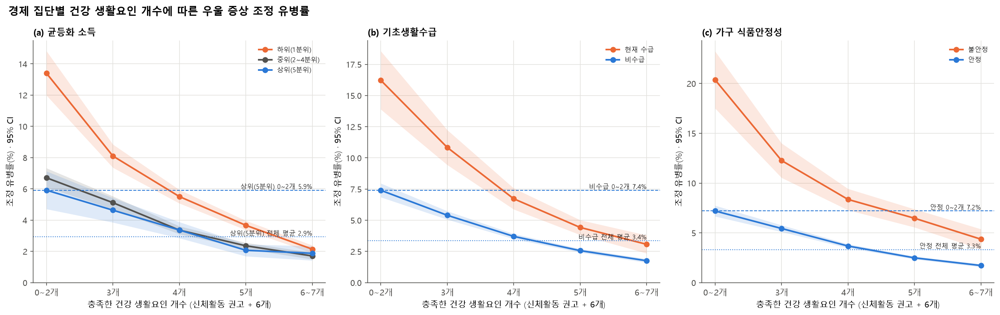
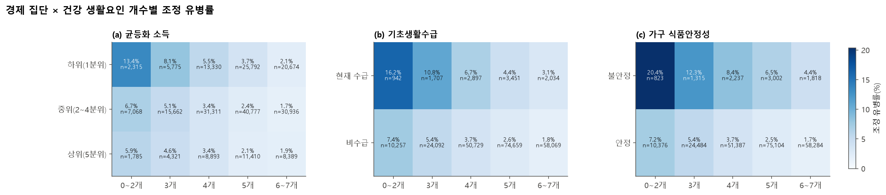

# 탐색 분석: 경제적 불리함을 건강 생활요인이 상쇄하는가 ("역전점" 분석)

> 탐색 단계(2026-10-21)에 공식 문서와 분리해 검토용으로 만든 보고서다. 원래 `src/v2/explore_econ_lifestyle.py`가 생성했고, 계산이 v3로 옮겨진 뒤에는 `src/v3/explore_report_v3.py`가 v3 집계표(`outputs/v3/reports/rev_*.csv`)로 같은 내용을 다시 만든다(2026-10-21). 이 검토를 바탕으로 v3 주제(「건강 생활요인은 경제적 불리함을 상쇄하는가」, `docs/v3/WORKFLOW_v3.md`)로 확정했다.
> 조정 유병률은 조사설계(가중치·층·집락)를 반영한 로지스틱 회귀의 예측 주변값이며, 인구·신체건강 변수를 조정했다(다른 경제 변수는 조정하지 않음).

## 질문
경제적으로 불리한 집단이 건강 생활요인(신체활동 권고 + 친구 연락·이웃 신뢰·비흡연·고위험음주 아님·아침식사·동네 안전)을 많이 충족하면, 생활요인이 적은 경제적 유리 집단보다 우울 증상 기준 충족률이 **낮아지는 지점(역전점)**이 있는가?

## 판정 기준
- **역전점** = 불리 집단의 조정 유병률이 비교 기준보다 낮고, 그 차이의 95% 신뢰구간 상한이 0 미만인 가장 낮은 생활요인 단계.
- 비교 기준은 세 가지다.
  - ① 유리 집단 중 생활요인 0~2개
  - ② 유리 집단 전체 평균(유리 집단의 실제 생활요인 분포로 가중)
  - ③ 유리 집단 같은 단계 — 같은 노력을 할 때 격차가 남는가

## 한눈에 보기

| 경제 지표 | 불리 vs 유리 | 역전점 ① (vs 유리 0~2개) | 역전점 ② (vs 유리 전체 평균) | 같은 단계 격차 (6~7개에서) | 감소 폭이 다른가(가법) | 승법 상호작용 p |
|---|---|---|---|---|---|---|
| 균등화 소득 | 하위(1분위) vs 상위(5분위) | **5개** | **6~7개** | +0.3%p [-0.3, +0.8] | -7.2%p [-9.1, -5.3] (p=0.000) | 0.000 |
| 기초생활수급 | 현재 수급 vs 비수급 | **5개** | **없음** | +1.3%p [+0.6, +2.1] | -7.5%p [-10.0, -5.0] (p=0.000) | 0.026 |
| 가구 식품안정성 | 불안정 vs 안정 | **6~7개** | **없음** | +2.6%p [+1.6, +3.7] | -10.5%p [-13.6, -7.5] (p=0.000) | 0.049 |

- 감소 폭 차이(가법) = (불리 집단의 0~2개→6~7개 변화) − (유리 집단의 같은 변화). 두 변화가 모두 음수(감소)이므로, **음수면 불리 집단에서 생활요인에 따른 유병률 감소 폭이 더 크다**는 뜻이다(%p 기준).

## 지표별 상세

### 균등화 소득 — 하위(1분위) vs 상위(5분위) (모형 n = 228,438)

| 경제 집단 | 0~2개 | 3개 | 4개 | 5개 | 6~7개 |
|---|---|---|---|---|---|
| 하위(1분위) | 13.4% [12.0, 14.8] (n=2,315) | 8.1% [7.4, 8.8] (n=5,775) | 5.5% [5.1, 5.9] (n=13,330) | 3.7% [3.4, 4.0] (n=25,792) | 2.1% [1.9, 2.4] (n=20,674) |
| 중위(2~4분위) | 6.7% [6.1, 7.3] (n=7,068) | 5.1% [4.7, 5.5] (n=15,662) | 3.4% [3.1, 3.6] (n=31,311) | 2.4% [2.2, 2.6] (n=40,777) | 1.7% [1.5, 1.9] (n=30,936) |
| 상위(5분위) | 5.9% [4.7, 7.1] (n=1,785) | 4.6% [3.9, 5.4] (n=4,321) | 3.4% [2.9, 3.9] (n=8,893) | 2.1% [1.7, 2.5] (n=11,410) | 1.9% [1.4, 2.3] (n=8,389) |

불리 집단(하위(1분위))의 단계별 차이 (조정 유병률 차, %p [95% CI]; **굵게** = 유의하게 낮음):

| 불리 집단 단계 | ① vs 유리 0~2개 | ② vs 유리 전체 평균 | ③ vs 유리 같은 단계 |
|---|---|---|---|
| 0~2개 | +7.5%p [+5.6, +9.3] | +10.5%p [+9.0, +11.9] | +7.5%p [+5.6, +9.3] |
| 3개 | +2.2%p [+0.7, +3.6] | +5.2%p [+4.4, +6.0] | +3.5%p [+2.4, +4.6] |
| 4개 | -0.4%p [-1.7, +0.9] | +2.6%p [+2.1, +3.1] | +2.1%p [+1.5, +2.8] |
| 5개 | **-2.2%p [-3.5, -1.0]** | +0.7%p [+0.3, +1.2] | +1.6%p [+1.1, +2.1] |
| 6~7개 | **-3.8%p [-5.0, -2.5]** | **-0.8%p [-1.1, -0.4]** | +0.3%p [-0.3, +0.8] |

- 생활요인 0~2개 → 6~7개 감소 폭: 하위(1분위) -11.3%p [-12.7, -9.8], 상위(5분위) -4.0%p [-5.3, -2.7] → 차이 -7.2%p [-9.1, -5.3], p = 0.000
- 생활요인 1개당 OR: 하위(1분위) 0.63 [0.61, 0.65], 상위(5분위) 0.72 [0.67, 0.77] (기울기 차이 p = 0.000)
- 승법 상호작용(경제 × 생활요인 단계 결합 Wald): F = 4.33, df = 8, p = 0.000

### 기초생활수급 — 현재 수급 vs 비수급 (모형 n = 228,837)

| 경제 집단 | 0~2개 | 3개 | 4개 | 5개 | 6~7개 |
|---|---|---|---|---|---|
| 현재 수급 | 16.2% [13.9, 18.6] (n=942) | 10.8% [9.4, 12.2] (n=1,707) | 6.7% [5.9, 7.6] (n=2,897) | 4.4% [3.8, 5.0] (n=3,451) | 3.1% [2.3, 3.8] (n=2,034) |
| 비수급 | 7.4% [6.9, 8.0] (n=10,257) | 5.4% [5.1, 5.7] (n=24,092) | 3.7% [3.5, 3.9] (n=50,729) | 2.6% [2.4, 2.7] (n=74,659) | 1.8% [1.6, 1.9] (n=58,069) |

불리 집단(현재 수급)의 단계별 차이 (조정 유병률 차, %p [95% CI]; **굵게** = 유의하게 낮음):

| 불리 집단 단계 | ① vs 유리 0~2개 | ② vs 유리 전체 평균 | ③ vs 유리 같은 단계 |
|---|---|---|---|
| 0~2개 | +8.8%p [+6.4, +11.2] | +12.9%p [+10.5, +15.2] | +8.8%p [+6.4, +11.2] |
| 3개 | +3.4%p [+2.0, +4.9] | +7.5%p [+6.1, +8.9] | +5.4%p [+4.0, +6.9] |
| 4개 | -0.7%p [-1.7, +0.3] | +3.4%p [+2.5, +4.2] | +3.0%p [+2.1, +3.9] |
| 5개 | **-3.0%p [-3.8, -2.2]** | +1.1%p [+0.5, +1.7] | +1.9%p [+1.2, +2.5] |
| 6~7개 | **-4.3%p [-5.3, -3.4]** | -0.3%p [-1.0, +0.4] | +1.3%p [+0.6, +2.1] |

- 생활요인 0~2개 → 6~7개 감소 폭: 현재 수급 -13.1%p [-15.6, -10.7], 비수급 -5.6%p [-6.2, -5.1] → 차이 -7.5%p [-10.0, -5.0], p = 0.000
- 생활요인 1개당 OR: 현재 수급 0.62 [0.58, 0.66], 비수급 0.69 [0.67, 0.71] (기울기 차이 p = 0.001)
- 승법 상호작용(경제 × 생활요인 단계 결합 Wald): F = 2.76, df = 4, p = 0.026

### 가구 식품안정성 — 불안정 vs 안정 (모형 n = 228,830)

| 경제 집단 | 0~2개 | 3개 | 4개 | 5개 | 6~7개 |
|---|---|---|---|---|---|
| 불안정 | 20.4% [17.5, 23.2] (n=823) | 12.3% [10.5, 14.0] (n=1,315) | 8.4% [7.3, 9.4] (n=2,237) | 6.5% [5.6, 7.4] (n=3,002) | 4.4% [3.3, 5.4] (n=1,818) |
| 안정 | 7.2% [6.7, 7.7] (n=10,376) | 5.4% [5.1, 5.8] (n=24,484) | 3.7% [3.5, 3.9] (n=51,387) | 2.5% [2.3, 2.6] (n=75,104) | 1.7% [1.6, 1.9] (n=58,284) |

불리 집단(불안정)의 단계별 차이 (조정 유병률 차, %p [95% CI]; **굵게** = 유의하게 낮음):

| 불리 집단 단계 | ① vs 유리 0~2개 | ② vs 유리 전체 평균 | ③ vs 유리 같은 단계 |
|---|---|---|---|
| 0~2개 | +13.2%p [+10.3, +16.1] | +17.1%p [+14.2, +19.9] | +13.2%p [+10.3, +16.1] |
| 3개 | +5.1%p [+3.3, +6.9] | +9.0%p [+7.2, +10.7] | +6.8%p [+5.1, +8.6] |
| 4개 | +1.2%p [-0.0, +2.4] | +5.0%p [+4.0, +6.1] | +4.7%p [+3.6, +5.8] |
| 5개 | -0.7%p [-1.8, +0.3] | +3.2%p [+2.2, +4.1] | +4.0%p [+3.1, +4.9] |
| 6~7개 | **-2.8%p [-4.0, -1.7]** | +1.1%p [+0.0, +2.1] | +2.6%p [+1.6, +3.7] |

- 생활요인 0~2개 → 6~7개 감소 폭: 불안정 -16.0%p [-19.0, -13.0], 안정 -5.5%p [-6.1, -4.9] → 차이 -10.5%p [-13.6, -7.5], p = 0.000
- 생활요인 1개당 OR: 불안정 0.65 [0.61, 0.69], 안정 0.69 [0.67, 0.71] (기울기 차이 p = 0.064)
- 승법 상호작용(경제 × 생활요인 단계 결합 Wald): F = 2.39, df = 4, p = 0.049

## 민감도: 소득 분석에 식품안정성·기초생활수급을 추가 조정
- 역전점 ① 4개, ② 6~7개; 감소 폭 차이 -3.4%p [-5.2, -1.6] (p = 0.000); 승법 p = 0.032
- 소득이 같아도 식품 불안정·수급 여부가 따로 작용하는 부분을 걷어낸 결과다. 주 분석과 결론이 같은지 확인용.

## 해석할 때 주의할 점
- **인과가 아니다.** 우울하지 않은 사람이 생활습관을 잘 지키는 역인과, 불리 집단 중 생활요인을 많이 충족하는 사람이 원래 심리적으로 건강한 집단일 가능성(선택)을 배제할 수 없다. 결론은 "상쇄와 일치하는 패턴이 관찰된다" 수준으로 쓴다.
- **생활요인 중 일부는 경제와 얽혀 있다.** 예를 들어 동네 안전 인식과 아침식사는 소득과 관련될 수 있다. 이 분석은 생활요인 개수를 하나의 묶음으로 본다.
- **비교가 많다.** 3개 지표 × 5단계 × 3기준. 신뢰구간 끝이 0에 가까운 경계선 결과는 보수적으로 읽는다.
- 칸 크기: 모든 칸 n ≥ 500(검증 assert).

## 공식 문서에 반영한다면 (제안 — 탐색 단계 당시)
- 위치: WORKFLOW_v2 5-2 뒤 "5-3. 경제적 불리함을 생활요인이 상쇄하는가", 노션 6-2 뒤, 논문 결과의 "신체활동과 생활요인의 조합" 뒤 하위 절 + 논의의 실천 제언·한계.
- 반영 전 확인: 지표별로 결론이 다르면 어떤 지표를 주 결과로 할지 정해야 한다(사전에 정하지 않은 탐색 분석이라는 점을 명시).
- 분석 대상: Y 산출 가능 231,290명 중 경제 지표·생활요인·조정변수가 모두 있는 사람.
- (이후 결정) v2 문서에 끼워 넣는 대신 독립 주제 v3로 재구성했다 — `docs/decision_log.md` D-33.